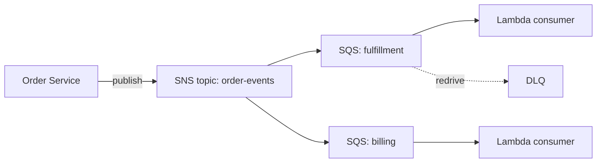

# ADR-0007: Amazon SQS + SNS for order event messaging

- **Status:** Proposed
- **Date:** 2026-10-10
- **Deciders:** Platform architecture, Order Services lead
- **Related:** ADR-0003 (serverless-first compute)

## Context
Order services poll a shared database for state changes. Peak polling load now accounts for a large share of database CPU and blocks the planned fulfillment integration. We need asynchronous event delivery before Q1 volume growth.

## Options considered
1. **Amazon SQS + SNS** managed queues with fan-out
2. **Amazon MSK (Kafka)** managed log with replay
3. **Defer** keep database polling

## Evaluation
| Option | Weighted score | % of max | Assumed inputs |
|---|---|---|---|
| Amazon SQS + SNS | 125.0 | 80.6 | 1/5 |
| Defer (keep DB polling) | 105.0 | 67.7 | 1/5 |
| Amazon MSK (Kafka) | 85.0 | 54.8 | 0/5 |

**Sensitivity:** SQS + SNS wins in 100% of 1,000 weight perturbations (+/-30%). The weight most likely to flip the result is lock-in, which would need to rise by 7 points.

## Decision
We will use SQS + SNS. It scores highest on operational burden and team skill fit, the two heaviest weights, and meets current throughput needs with wide headroom.

## Design

## Consequences
**Positive**
- No brokers to patch or size; consumers scale with queue depth.
- Fan-out to new consumers requires no producer change.

**Negative / accepted risks**
- AWS-specific APIs raise exit cost.
- No native replay; recovery depends on DLQ redrive and an archive consumer.

**Pre-mortem findings**
| Risk | Likelihood | Impact | Mitigation |
|---|---|---|---|
| Event replay becomes a requirement | M | H | Add an S3 archive consumer now; revisit Kafka if replay SLAs appear |
| Duplicate delivery corrupts billing | M | H | Idempotency keys on consumers |
| Cost estimate wrong (assumed input) | L | M | Cost alarm at 150% of forecast |

## Revisit when
- Replay or event-sourcing becomes a stated requirement
- Sustained throughput exceeds 10k msgs/sec
- Monthly messaging cost exceeds $2,000
