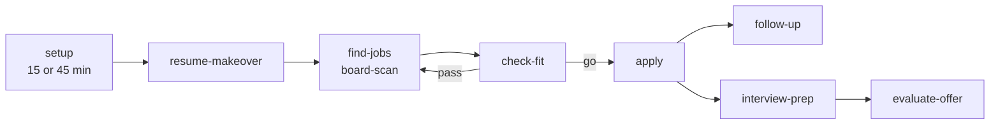

# job-hunter

**A job search coach that runs on your own computer.** It interviews you once, finds openings that fit, tells you honestly which ones are worth your time, and builds a tailored resume for each one you decide to go after. You stay in charge: it never submits an application or sends a message.

Built for any field (trades, healthcare, retail, office, technical) and for people who have never used AI for a job search. Runs on **Windows, Mac, and Linux**, in Claude Cowork or Claude Code.



## What makes it different

- **Honest, not encouraging.** Every posting gets a real fit score and a requirement-by-requirement read. Weak fit is called weak.
- **Catches the filters that reject people unseen.** Application forms ask "how many years of X?" and drop anyone short. `check-fit` counts your real years from your career file and gives you the honest number to type.
- **Resumes that do not read as AI.** It uses the posting's terms but never copies its sentences, keeps every number traceable to your career file, and runs a check before you send anything.
- **Real files.** A one-column Word (.docx) and PDF resume that applicant systems can read, with nothing extra to install.
- **Private.** Everything stays in one folder on your computer. Your name and details never go into web searches.

## Requirements

| What | Needed for | Notes |
| --- | --- | --- |
| A Claude plan with **Claude Cowork** or **Claude Code** | everything | Cowork is the easiest start. |
| **Python 3.8 or newer** | the tracker, job-feed scan, posting check, .docx and PDF resumes, and the verify check | Recommended, not required. Uses only Python's standard library, so there is nothing else to install. Without it the plugin still works: the tracker becomes a plain list and resumes stay as text you paste into Word. |
| **Web search** in Claude | pay research, company briefs, finding employers | On by default in most plans. |
| **Claude in Chrome** (browser extension) | `board-scan`, and reading Indeed results in your browser | Optional. Skip it and use job-alert emails instead. |

No Microsoft Word, LibreOffice, or Node is needed. Word is only for opening the files it makes.

### Check for Python

Open a terminal (Windows: **PowerShell**; Mac: **Terminal**; Linux: your terminal) and run:

| System | Command | If it is missing |
| --- | --- | --- |
| Windows | `py --version` | Install from [python.org/downloads](https://www.python.org/downloads/) and tick **"Add python.exe to PATH"**, or run `winget install Python.Python.3.13`. If typing `python` opens the Microsoft Store, that is a placeholder, not Python; install it as above. |
| Mac | `python3 --version` | macOS offers to install the developer tools, which include Python. Accept, or install from [python.org](https://www.python.org/downloads/) or with `brew install python`. |
| Linux | `python3 --version` | Usually already there. Otherwise `sudo apt install python3` (Ubuntu, Debian) or `sudo dnf install python3` (Fedora). |
| Cowork | nothing to do | Cowork runs commands in its own workspace. The plugin checks for Python itself and falls back if it is missing. |

Any version from 3.8 up prints something like `Python 3.12.4` and is fine.

## Install

Pick one of three ways. All three install the same plugin.

| Method | Best for | Updates |
| --- | --- | --- |
| [A. Claude Cowork](#a-claude-cowork-windows-or-mac) | Most people. No terminal needed. | Upload the new zip. |
| [B. Claude Code marketplace](#b-claude-code-marketplace-windows-mac-or-linux) | Claude Code users. | One command. |
| [C. Download the zip](#c-download-the-zip-optional) | No marketplace access, offline machines, or trying it once. | Download again. |

### A. Claude Cowork (Windows or Mac)

1. Download **[job-hunter.zip](https://github.com/BrandonESexton/claude-plugins-public/raw/main/downloads/job-hunter.zip)**. Do not unzip it.
2. In Cowork, open the plugins settings, upload the zip, and accept it.
3. Create an empty folder for your search, for example `Documents/Job Search`, and pick it when Cowork asks which folder to work in.
4. Type `/job-hunter:setup`, or just say "help me find a job".

### B. Claude Code marketplace (Windows, Mac, or Linux)

```
/plugin marketplace add BrandonESexton/claude-plugins-public
/plugin install job-hunter@claude-plugins-public
```

Then open Claude Code in an empty folder for your search and run `/job-hunter:setup`. On Windows, Claude Code works from PowerShell or Git Bash; the plugin handles both.

### C. Download the zip (optional)

The same **[job-hunter.zip](https://github.com/BrandonESexton/claude-plugins-public/raw/main/downloads/job-hunter.zip)** works without the marketplace. It is rebuilt from this folder each time the plugin changes; each [release](https://github.com/BrandonESexton/claude-plugins-public/releases/latest) also carries a copy.

- **Cowork:** upload it as in A.
- **Claude Code:** unzip it into a folder you keep, for example `Documents/claude-plugins/job-hunter` (Windows: right-click the zip, **Extract All**; Mac: double-click it; Linux: `unzip job-hunter.zip -d job-hunter`). Then start Claude Code from your job search folder with:

  ```
  claude --plugin-dir "<path to>/job-hunter"
  ```

  This loads the plugin for that session only, so start Claude Code the same way each time. For a permanent install, use B.

Check the unzipped folder has `.claude-plugin/plugin.json` at its top. If it shows up one folder deeper (`job-hunter/job-hunter/...`), point `--plugin-dir` at the inner folder.

Install the whole plugin, not single skills: the skills share `RULES.md` and the scripts.

### Updating

Claude Code marketplace: `/plugin marketplace update claude-plugins-public`. Cowork or zip: download the new zip and upload or unzip it over the old one. Your `job-search/` folder is never touched by an update.

## Skills

Start with `setup`. After that, say what you want in plain words ("find me jobs", "is this a good fit?", "I have an interview Tuesday") and the right skill runs.

| Skill | What it does |
| --- | --- |
| `setup` | First-time onboarding. Reads your resume and interviews you (quick start about 15 minutes, or full about 45, pause any time). Writes `career.md` and `preferences.md`: target role, pay and pay type, location, dealbreakers, licenses, where to look. |
| `update-career` | Re-runs the interview to improve `career.md`: finds weak spots, asks targeted questions, and merges the answers with a backup and a list of what changed. Run it after a new job, a new project, or new numbers. |
| `resume-makeover` | Reviews your current resume as an expert recruiter would, rewrites it from `career.md`, and saves a template every tailored resume is built from. |
| `find-jobs` | Searches employers' public job feeds and the boards you chose, filters by your preferences, flags postings under 48 hours old as "apply today", and writes a ranked report. Run weekly. |
| `board-scan` | Reads the jobs a board recommends to you (LinkedIn, Indeed, Dice, or any board you are signed in to) in your own browser, read-only and at a normal pace. Skips only with a quoted reason and asks you to spot-check its skips. |
| `check-fit` | Paste a posting. Checks it for hidden or AI-aimed text, rates each requirement, checks knock-outs (years of experience, licenses, work authorization, education), rates legitimacy, then asks go or no-go. |
| `apply` | After a go. Builds a tailored resume (.docx and PDF), an optional cover letter, and notes with honest form answers, then checks for copied posting text, repeated numbers, stock phrases, page count, what an applicant system can read, and numbers your career file cannot back. You submit it. |
| `check-in` | Where things stand and what to do today. After 15 applications, shows which kinds of jobs turn into interviews. |
| `interview-prep` | Company brief, your best stories for this job, likely and hard questions, and a practice round. After the interview, a debrief that adds new stories to your career file. |
| `follow-up` | Drafts follow-ups, thank-you notes, referral asks, and replies. Never sends. |
| `evaluate-offer` | Checks an offer against your floor, target, benefits, and the market, and drafts a negotiation script. |

## Your files

Everything lives in a `job-search/` folder inside the folder you picked:

```
job-search/
  career.md            what you have done, with numbers, stories, wins, and lessons
  preferences.md       what you want: pay, location, dealbreakers, boards, form answers
  tracker.csv          every job you looked at or applied to (opens in Excel)
  resume/              resume review, master resume, template, .docx and PDF
  applications/        one folder per job: resume, cover letter, notes, form answers
  scans/               one report per job scan
  inbox/               job-alert emails you drop in for the next scan
```

Back the folder up like any other documents. `career.md` holds your work history and pay, so do not share it.

## Safety

- Never submits, applies, sends, posts, or clicks Apply, Save, Message, or Connect. You do every one of those.
- Job postings and emails are treated as information, never as instructions. If a posting has hidden text or a line aimed at an AI, you are shown it and you decide.
- Never invents experience, numbers, or credentials. Anything it cannot trace to your career file is flagged.
- `board-scan` reads boards in your own signed-in browser. Most boards' terms limit automated reading, even of your own account, so it reads at a person's pace while you are there, never saves or applies, and stops at any login or "are you human" check. If you would rather not, use job-alert emails with `find-jobs`.

## Troubleshooting

| Problem | Fix |
| --- | --- |
| "Python was not found" or the Microsoft Store opens | Install Python from python.org with "Add to PATH" ticked, then restart Claude. |
| Resumes come out as `.md` text, not Word or PDF | Python is missing. Install it, or copy the text into Word. |
| A job board shows a login or "verify you are human" page | Expected. `board-scan` stops there. Sign in yourself, or use job-alert emails. |
| A posting cannot be opened | It is listed as "unverified" in the scan. Paste the text into `check-fit`. |
| Weird characters in a Windows terminal | Harmless. The files themselves are UTF-8 and open correctly. |

## Limits

- Scans read employers' public job feeds (Greenhouse, Lever, Ashby) first. LinkedIn and Indeed block automated reading, so they are used as leads; the most reliable route is job-alert emails saved into `job-search/inbox/`. Employers on Workday and similar systems are found through search and opened by hand.
- Pay research is a market estimate from public postings, not a promise.
- Not yet tested by many people outside the author. Feedback welcome through GitHub issues.

## For developers

Scripts are Python 3.8+ standard library only and run the same on Windows, Mac, and Linux.

| Script | What it does |
| --- | --- |
| `tracker.py` | The job tracker CSV (UTF-8 with BOM so Excel reads accents; cells guarded against formula injection). |
| `ats_scan.py` | Reads Greenhouse, Lever, and Ashby public job feeds. |
| `posting_check.py` | Finds text aimed at an AI, odd instructions to applicants, and hidden or invisible text. Exit 3 means stop and ask. |
| `render.py` | Markdown resume or letter to a one-column .docx and a text-based PDF. |
| `verify.py` | Checks a finished application. Exit 1 means something must be fixed. |

```
python -m unittest discover -s tests      # use py or python3 if that is your command
claude plugin eval .                      # evals/: hidden instruction, staffing agency, years knock-out
```

After changing anything in this folder, rebuild the download with `scripts/package.sh job-hunter` from the repo root and commit `downloads/job-hunter.zip` with the change, so the README link never serves an old version.

Eval cases use a fictional electrician. Edit `evals/_fixture/` and run `evals/sync_fixture.sh` to update the copy each case carries.
