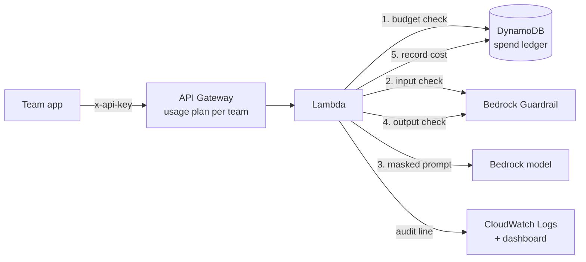

# AI Gateway

A governed entry point for internal AI use on AWS. Teams call one API. The gateway checks budget, applies data policy, calls the model, checks the response, records cost, and writes an audit line. Everything is Terraform.

## Why

Most companies don't fail at AI because the model is bad. They fail because nobody can answer three questions: what data went to the model, who is spending what, and how do we stop it when something goes wrong. This answers all three at the platform layer instead of trusting every app team to get it right.

## Architecture

## What it enforces

| Layer | Control | Behavior |
|---|---|---|
| Access | Per-team API key | No key, no entry. Key maps to a team for attribution. |
| Rate | Usage plan | Per-team rate, burst, and daily quota at the edge |
| Spend | DynamoDB ledger | Token-level cost per request; team cut off at monthly budget |
| Data, low risk | Guardrail ANONYMIZE | Email, phone, employee IDs masked before the model sees them |
| Data, high risk | Guardrail BLOCK | SSNs, card numbers, AWS keys stop the request |
| Abuse | Prompt attack filter | Jailbreak and injection attempts blocked on input |
| Policy | Denied topic | Requests about named employees' compensation blocked |
| Output | Guardrail on response | Model output checked before the user sees it |
| Audit | Structured log | Who, team, model, policies fired, tokens, cost. No prompt text. |

## Design decisions

- **Mask vs block is a risk tier, not a default.** Blocking everything kills adoption. Masking an email lets work continue. A secret in a prompt is an incident, so it stops.
- **Input and output masking are declared explicitly.** Default settings silently skipped masking on input while blocking still worked. I caught it by testing each policy type in isolation (ML detector, regex, block rule) and fixed it by declaring input and output behavior for every entity.
- **Every policy change publishes a new guardrail version.** The Lambda pins to a numbered version, so the policy in production is always one that was deliberately published.
- **The audit log stores no prompt text.** If the audit log keeps raw prompts, the log becomes a new PII store.
- **The budget check runs first.** It's the cheapest check, and an over-budget team shouldn't cost anything.
- **Edge throttling is best effort, so the hard limit lives in the ledger.** API Gateway usage plan limits are approximate. The DynamoDB ledger is the enforced ceiling.
- **Model-agnostic by config.** The Converse API plus a `model_id` variable means switching providers is a one-line change.
- **Remote state** in S3 with versioning, encryption, and native locking. State holds API keys, so it never touches git.
- **Least privilege throughout.** The Lambda can invoke models, use one guardrail, write one log group, and touch one table. The deploy user can only reach its own state bucket and dashboard.

## Known limits and next steps

- **Authentication.** API keys identify callers, they don't authenticate them. Next step is a JWT authorizer backed by Okta or Entra ID so `user` comes from a verified token.
- **Budget overshoot.** The check-then-spend design can overshoot by about one request per concurrent call. A hard ceiling would reserve estimated cost with a conditional write and settle afterward.
- **Re-hydration.** Masked values come back as `{EMAIL}`. Swapping originals back in for the requesting user would improve usefulness without exposing data to the model provider.
- **CI/CD.** Plan on pull request, apply on merge, with policy changes reviewed like code.

## Cost

Testing all phases cost under a dollar. Idle cost is effectively zero: Lambda, DynamoDB on-demand, and API Gateway bill per request, and the guardrail bills per check.

## Teardown

1. `terraform destroy`, and read the list before typing yes
2. Empty and delete the state bucket in the S3 console (versioned buckets need **Empty** first)
3. Delete the `ai-gateway-dev` access key, then the user and group
4. Check Cost Explorer next month filtered by `Project = ai-gateway`